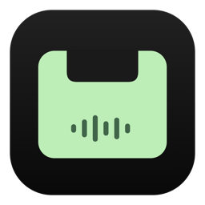
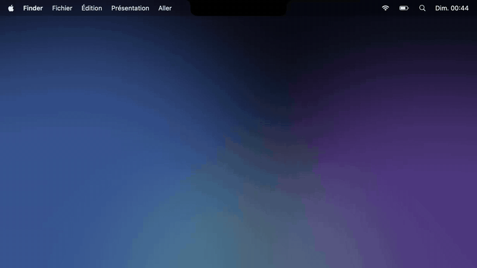
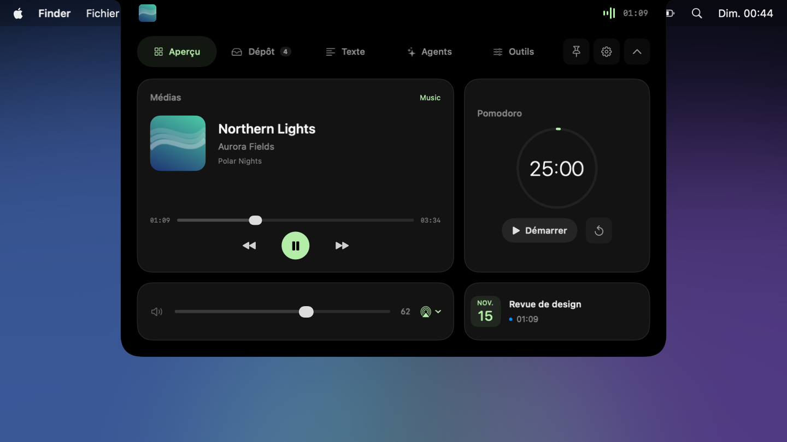
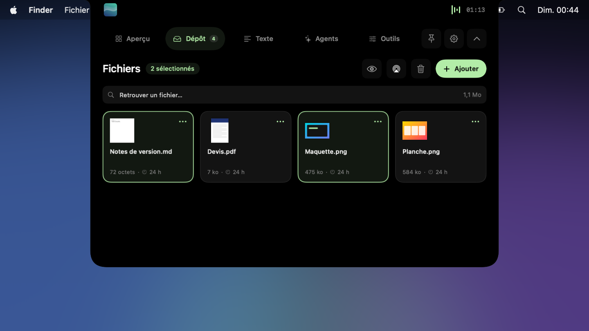
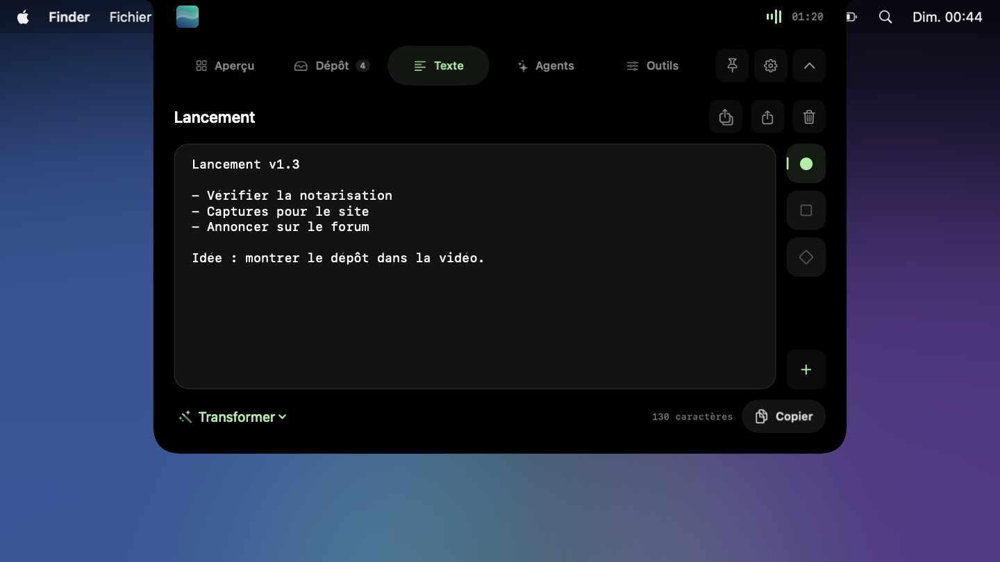
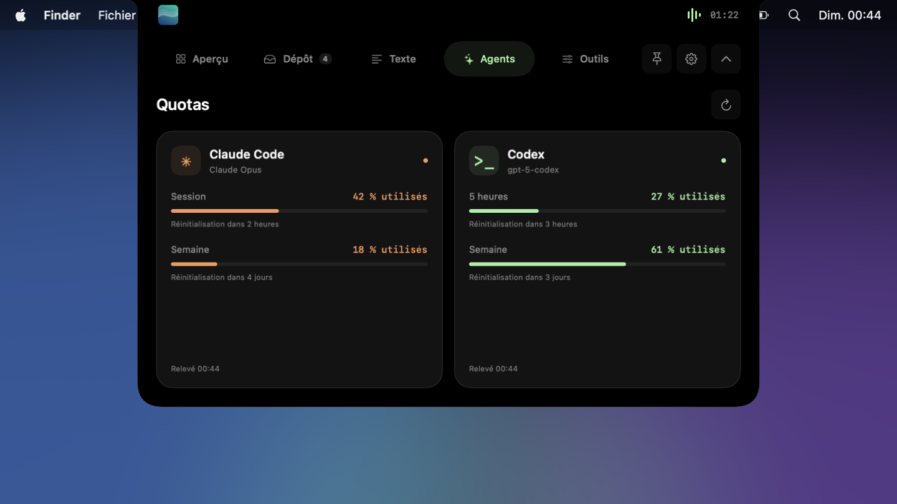

<div align="center">



# Notcher

**Le notch de ton MacBook devient un espace de travail.**

La musique, un dépôt de fichiers, des fiches texte, tes quotas d'agents de code et une dizaine de petits outils, à un survol.<br>
SwiftUI + AppKit natif · aucune dépendance · tout reste sur ton Mac.

[](https://github.com/Dacryoserum/Notcher/releases/latest)


[](https://github.com/Dacryoserum/Notcher/actions/workflows/ci.yml)

[**Télécharger pour Apple silicon**](https://github.com/Dacryoserum/Notcher/releases/latest) · [Compiler depuis les sources](#compiler-depuis-les-sources) · [English](README.md)

<br>

<a href="docs/media/fr/demo.mp4"></a>

<sub>▶ <a href="docs/media/fr/demo.mp4">Voir en pleine qualité</a></sub>

</div>

## En bref

- **Un notch qui te parle.** Au repos, il reste nu. Il s'anime quand il a quelque chose à dire : le morceau qui commence, Claude Code qui répond, attend ta permission ou a terminé, un téléchargement fini, un rendez-vous dans quelques minutes, une batterie faible, tes AirPods qui se connectent avec la charge de chaque écouteur.
- **À un survol.** Il s'ouvre au survol, au survol puis clic, ou au clic seulement. Il se referme tout seul quand tu pars, sauf si tu l'épingles.
- **Un aperçu que tu composes.** Onze widgets (musique, Pomodoro, volume, agenda, texte, presse-papiers, dépôt, batterie, quotas, horloge, éveil) sur une grille que tu organises et redimensionnes ; chacun en montre plus quand il grandit.
- **Pensé aussi pour le clavier.** Un raccourci global que tu choisis, `⌘1`…`⌘5` entre les onglets, les touches du Finder dans le dépôt.
- **Soigné jusqu'aux détails.** Retour haptique du trackpad, trois styles d'animation, la couleur de ton choix, l'option Réduire les animations respectée, en français et en anglais.

## Ce qu'il y a dedans

<table>
<tr>
<td width="50%"></td>
<td width="50%"></td>
</tr>
<tr>
<td><b>Aperçu</b> : les widgets que tu as choisis, disposés comme tu veux. La musique avec pochette, progression et commandes ; ton prochain rendez-vous avec son lien de réunion ; un Pomodoro qui se lance depuis son cadran.</td>
<td><b>Dépôt</b> : dépose des fichiers sur le notch pour en garder une copie sous la main. Vraies miniatures, Quick Look avec <kbd>Espace</kbd>, sélection multiple et glisser de plusieurs fichiers d'un coup, AirDrop. Les copies expirent après le délai choisi sauf si tu les épingles, et chaque retrait s'annule.</td>
</tr>
<tr>
<td></td>
<td></td>
</tr>
<tr>
<td><b>Texte</b> : des fiches de brouillon, chacune avec son propre historique d'annulation. Formater ou compacter du JSON, encoder et décoder du Base64 ou des URL, trier et dédoublonner des lignes, envoyer une fiche vers Notes ou l'exporter.</td>
<td><b>Agents</b> : les limites de Claude Code et de Codex d'un coup d'œil, avec l'heure de leur remise à zéro.</td>
</tr>
</table>

**Outils** : un Pomodoro avec sa liste de tâches, un calendrier du mois, un miroir caméra, l'historique du presse-papiers (en mémoire seulement, désactivé par défaut), tes Raccourcis, les réglages système (volume et sortie, luminosité, garder le Mac éveillé pour une durée, appareils Bluetooth), un prompteur qui lit une fiche et un convertisseur d'images vers PNG, JPEG, WebP, TIFF ou PDF.

## Installer

1. Télécharge `Notcher-<version>-macos-arm64.zip` depuis la [dernière version](https://github.com/Dacryoserum/Notcher/releases/latest).
2. Décompresse-le et déplace **Notcher.app** dans **Applications**.
3. Ouvre-le. Notcher vit dans la barre des menus, sans icône dans le Dock.

> [!NOTE]
> L'app est signée « ad hoc » et n'est pas notarisée. Si macOS bloque le premier lancement, ouvre **Réglages Système → Confidentialité et sécurité** et clique sur **Ouvrir quand même**. Une seule fois suffit.

Demande **macOS 14 Sonoma ou plus récent**. La version publiée est compilée pour Apple silicon ; sur un Mac Intel, [compile-la depuis les sources](#compiler-depuis-les-sources). Notcher est fait pour les Mac à encoche, et en dessine une sur les autres écrans.

Notcher se met à jour tout seul : il interroge GitHub une fois par jour, affiche un point vert dans le panneau quand une version est prête et l'installe en un clic depuis les Réglages. Chaque téléchargement est vérifié par une empreinte SHA-256 et une signature ed25519 avant d'être installé.

## Utilisation

| | |
|---|---|
| Ouvrir ou fermer le panneau depuis n'importe où | <kbd>⌘</kbd><kbd>⇧</kbd><kbd>Espace</kbd> (modifiable dans **Réglages → Comportement**) |
| Fermer le panneau | <kbd>Échap</kbd>, ou éloigner le pointeur |
| Changer d'onglet | <kbd>⌘1</kbd> … <kbd>⌘5</kbd> |
| Garder le panneau ouvert | le bouton épingle |
| Réglages, Quitter | clic droit sur le notch, ou l'icône de la barre des menus |
| **Dépôt :** aperçu, retirer, tout sélectionner, annuler | <kbd>Espace</kbd>, <kbd>⌫</kbd>, <kbd>⌘A</kbd>, <kbd>⌘Z</kbd> |
| **Dépôt :** sélectionner plusieurs fichiers | <kbd>⌘</kbd>-clic, <kbd>⇧</kbd>-clic |

Dépose un fichier ou du texte n'importe où sur le notch, même fermé : il arrive dans le dépôt.

### Claude Code

Dans **Réglages → Services**, **Connecter** ajoute Notcher à la barre d'état et aux hooks de Claude Code, dans `~/.claude/settings.json`. Ta propre commande de barre d'état continue de tourner et de s'afficher. Notcher reçoit alors tes limites à chaque réponse et sait quand Claude commence, attend une permission ou termine. **Déconnecter** remet tes réglages comme avant.

### Codex

Active Codex dans **Réglages → Services**. Notcher trouve le CLI `codex` tout seul (ou utilise le chemin que tu indiques) et lit les limites du compte connecté.

## Confidentialité

Tes fiches, ton dépôt et tes réglages restent sur ton Mac, dans `~/Library/Application Support/Notcher`. Pas de compte, pas de statistiques, pas de pistage. Notcher ne se connecte que pour chercher les mises à jour sur GitHub et récupérer la pochette que ton lecteur de musique indique. L'historique du presse-papiers reste en mémoire et s'efface quand tu le désactives. L'accès au calendrier, à la caméra et à l'automatisation n'est demandé que lorsque tu utilises la fonction qui en a besoin.

## Compiler depuis les sources

Il faut les Command Line Tools de Xcode (`xcode-select --install`). La compilation vise le Mac utilisé, Apple silicon ou Intel.

```sh
git clone https://github.com/Dacryoserum/Notcher.git
cd Notcher
./Scripts/build.sh          # compilation release, dans dist/Notcher.app
open dist/Notcher.app
```

### Développement

```sh
./Scripts/run.sh            # compilation debug, quitte la copie en cours et lance la nouvelle
./Scripts/test.sh           # tests unitaires et d'intégration
./Scripts/record-demo.sh    # réenregistre la vidéo et les captures de docs/media (demande ffmpeg)
```

| Dossier | |
|---|---|
| `Sources/NotcherCore` | La logique sans interface : stockage du dépôt, grille des widgets, lecture des quotas, mises à jour, raccourcis. Entièrement testée. |
| `Sources/Notcher/App` | Cycle de vie de l'app, la fenêtre du notch et sa géométrie, l'enregistreur de démo. |
| `Sources/Notcher/Services` | Médias, système, agenda, agents, stockage, mises à jour. |
| `Sources/Notcher/Views` | Les vues SwiftUI de chaque onglet et des réglages. |
| `App/` | `Info.plist`, l'icône, les textes anglais et français. Le français est la langue source. |
| `Tests/` | `NotcherCoreTests` pour le cœur, `NotcherIntegrationTests` pour la cible de l'app. |

Les vérifications qui demandent une vraie session (permissions Spotify, Bluetooth, écrans, veille) sont listées dans [docs/VALIDATION.md](docs/VALIDATION.md).

### Publier une version

```sh
./Scripts/release.sh --init-key   # une seule fois : crée la clé de signature dans le trousseau
./Scripts/release.sh --publish    # tests, compilation, archive et manifeste signés, brouillon de release
```

Les notes affichées dans l'app viennent de `RELEASE_NOTES.md`. La clé privée ne quitte jamais le trousseau du Mac qui publie. Garde-en une copie en lieu sûr : sans elle, les copies installées ne peuvent plus être mises à jour.

## À propos

Notcher est un projet indépendant, inspiré de [NotchNook](https://lo.cafe/notchnook). Il n'en reprend ni le code, ni les ressources, ni la marque.

© Dacryoserum. Tous droits réservés. Le code est publié pour que tu puisses le lire, le compiler et signaler des problèmes ; aucune licence de réutilisation n'est accordée.
