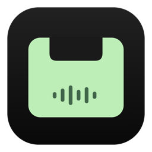
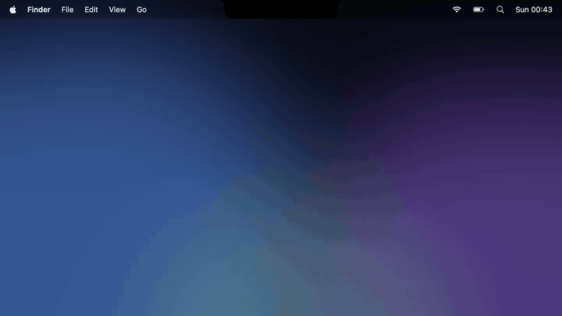
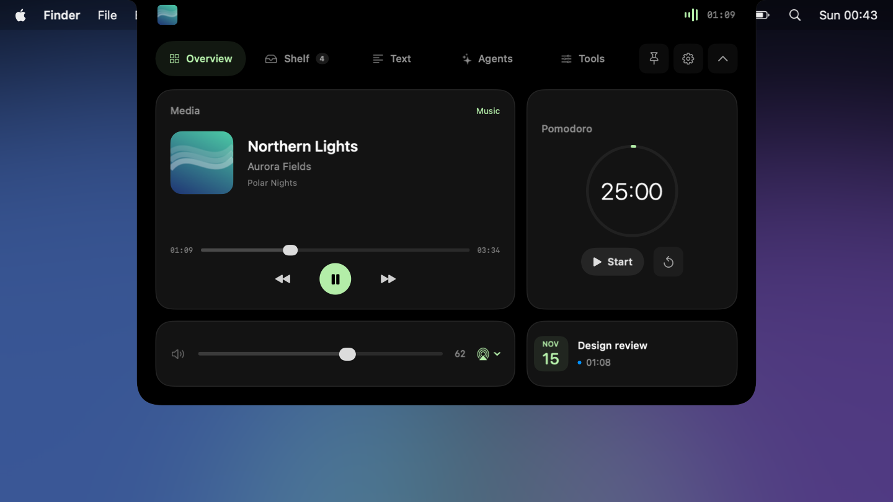
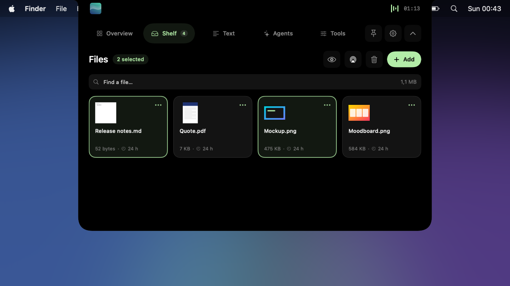
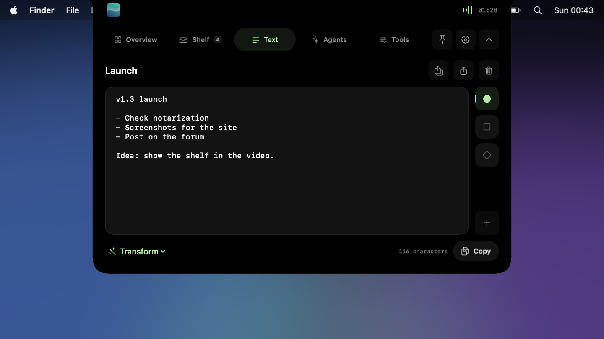
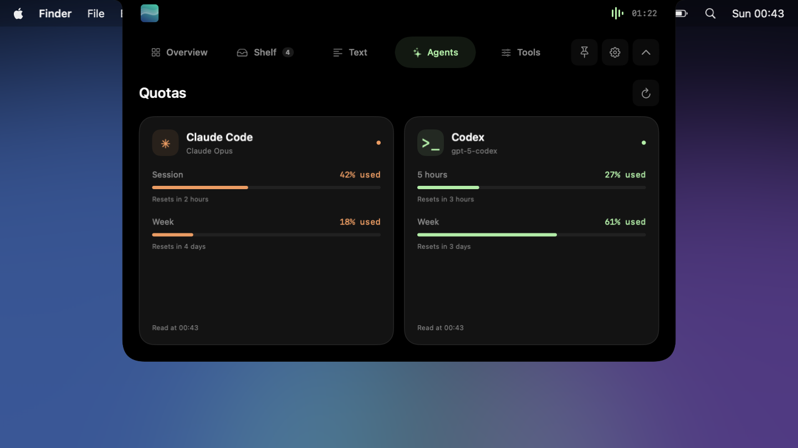

<div align="center">



# Notcher

**Your MacBook's notch, turned into a workspace.**

Music, a file shelf, text sheets, your AI coding quotas and a dozen small tools, one hover away.<br>
Native SwiftUI + AppKit · no dependencies · everything stays on your Mac.

[](https://github.com/Dacryoserum/Notcher/releases/latest)


[](https://github.com/Dacryoserum/Notcher/actions/workflows/ci.yml)

[**Download for Apple silicon**](https://github.com/Dacryoserum/Notcher/releases/latest) · [Build from source](#build-from-source) · [Français](README.fr.md)

<br>

<a href="docs/media/demo.mp4"></a>

<sub>▶ <a href="docs/media/demo.mp4">Watch in full quality</a></sub>

</div>

## Highlights

- **A notch that tells you things.** At rest it stays bare. It wakes up when it has something to say: the song that just started, Claude Code answering, waiting for your permission or done, a download that finished, a meeting in a few minutes, a low battery, your AirPods connecting with each earbud's charge.
- **One hover away.** Open it on hover, on hover then click, or on click only. It closes by itself when you leave, unless you pin it.
- **An overview you compose.** Eleven widgets (music, Pomodoro, volume, calendar, text, clipboard, shelf, battery, quotas, clock, keep awake) on a grid you arrange and resize, each one showing more as it grows.
- **Built for the keyboard too.** A global shortcut you choose, `⌘1`…`⌘5` between tabs, Finder-style keys on the shelf.
- **Polished down to the details.** Haptic feedback on the trackpad, three animation styles, a colour of your choice, Reduce Motion respected, English and French.

## What's inside

<table>
<tr>
<td width="50%"></td>
<td width="50%"></td>
</tr>
<tr>
<td><b>Overview</b> — the widgets you picked, laid out the way you want. Music with cover, timeline and controls; your next event with its meeting link; a Pomodoro you start from its dial.</td>
<td><b>Shelf</b> — drop files on the notch to keep a copy at hand. Real thumbnails, Quick Look with <kbd>Space</kbd>, multi-select and drag several files out at once, AirDrop. Copies expire after the delay you set unless you pin them, and every removal can be undone.</td>
</tr>
<tr>
<td></td>
<td></td>
</tr>
<tr>
<td><b>Text</b> — scratch sheets, each with its own undo history. Format or compact JSON, encode and decode Base64 or URLs, sort and dedupe lines, send a sheet to Notes or export it.</td>
<td><b>Agents</b> — your Claude Code and Codex rate limits at a glance, with when they reset.</td>
</tr>
</table>

**Tools** — Pomodoro with a task list, a month calendar, a camera mirror, clipboard history (memory only, off by default), your Shortcuts, system controls (volume and output, brightness, keep awake for a set time, Bluetooth devices), a teleprompter that reads a sheet, and an image converter to PNG, JPEG, WebP, TIFF or PDF.

## Install

1. Download `Notcher-<version>-macos-arm64.zip` from the [latest release](https://github.com/Dacryoserum/Notcher/releases/latest).
2. Unzip it and move **Notcher.app** to **Applications**.
3. Open it. Notcher lives in the menu bar, with no Dock icon.

> [!NOTE]
> The app is signed ad hoc and not notarized. If macOS blocks the first launch, open **System Settings → Privacy & Security** and click **Open Anyway**. You only need to do this once.

Requires **macOS 14 Sonoma or later**. The release is built for Apple silicon; on an Intel Mac, [build from source](#build-from-source). Notcher works best on a Mac with a notch, and draws one on other screens.

Notcher updates itself: it checks GitHub once a day, shows a green dot in the panel when a version is ready, and installs it in one click from Settings. Every download is checked against a SHA-256 checksum and an ed25519 signature before it is installed.

## Using it

| | |
|---|---|
| Open or close the panel from anywhere | <kbd>⌘</kbd><kbd>⇧</kbd><kbd>Space</kbd> (change it in **Settings → Behavior**) |
| Close the panel | <kbd>Esc</kbd>, or move the pointer away |
| Switch tabs | <kbd>⌘1</kbd> … <kbd>⌘5</kbd> |
| Keep the panel open | the pin button |
| Settings, Quit | right-click the notch, or the menu bar icon |
| **Shelf:** preview, remove, select all, undo | <kbd>Space</kbd>, <kbd>⌫</kbd>, <kbd>⌘A</kbd>, <kbd>⌘Z</kbd> |
| **Shelf:** select several | <kbd>⌘</kbd>-click, <kbd>⇧</kbd>-click |

Drop a file or some text anywhere on the notch, even closed, and it lands on the shelf.

### Claude Code

In **Settings → Services**, **Connect** adds Notcher to Claude Code's status line and hooks in `~/.claude/settings.json`. Your existing status line command keeps running and its output still shows. Notcher then receives your rate limits with each answer and knows when Claude starts, needs a permission or finishes. **Disconnect** puts your settings back as they were.

### Codex

Turn on Codex in **Settings → Services**. Notcher finds the `codex` CLI on its own (or use the path you give) and reads the limits of the account it is signed in to.

## Privacy

Your sheets, shelf and settings stay on your Mac, in `~/Library/Application Support/Notcher`. There is no account, no analytics and no tracking. Notcher only goes online to check GitHub for updates and to fetch the cover art your music player points to. Clipboard history stays in memory and is cleared when you turn it off. Calendar, camera and automation access are asked for only when you use the feature that needs them.

## Build from source

You need the Xcode Command Line Tools (`xcode-select --install`). The build targets the Mac you build on, Apple silicon or Intel.

```sh
git clone https://github.com/Dacryoserum/Notcher.git
cd Notcher
./Scripts/build.sh          # release build, in dist/Notcher.app
open dist/Notcher.app
```

### Development

```sh
./Scripts/run.sh            # debug build, quits the running copy, starts the new one
./Scripts/test.sh           # unit and integration tests
./Scripts/record-demo.sh    # re-records the video and screenshots in docs/media (needs ffmpeg)
```

| Path | |
|---|---|
| `Sources/NotcherCore` | Logic without UI: shelf storage, widget grid, usage parsing, updates, shortcuts. Fully unit tested. |
| `Sources/Notcher/App` | App lifecycle, the notch window and its geometry, the demo recorder. |
| `Sources/Notcher/Services` | Media, system, calendar, agents, storage, updates. |
| `Sources/Notcher/Views` | SwiftUI views for each tab and the settings. |
| `App/` | `Info.plist`, icon, and the English and French strings. French is the source language. |
| `Tests/` | `NotcherCoreTests` for the core, `NotcherIntegrationTests` for the app target. |

Interactions that need a real session (Spotify permissions, Bluetooth, screens, sleep) are listed in [docs/VALIDATION.md](docs/VALIDATION.md).

### Releasing

```sh
./Scripts/release.sh --init-key   # once: creates the update signing key in the keychain
./Scripts/release.sh --publish    # tests, build, signed archive and manifest, draft GitHub release
```

The release notes shown in the app come from `RELEASE_NOTES.md`. The private key never leaves the keychain of the Mac that publishes. Keep a copy somewhere safe: without it, installed copies can no longer be updated.

## About

Notcher is an independent project, inspired by [NotchNook](https://lo.cafe/notchnook). It shares none of its code, assets or branding.

© Dacryoserum. All rights reserved. The source is published so you can read it, build it and report issues; no licence to reuse it is granted.
